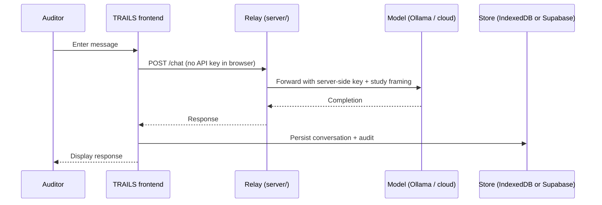

# TRAILS — Chatbot Auditing Platform

TRAILS is a research tool for running structured **bias/harm audits of chatbots**. An
investigator configures a study (model, framing prompt, questionnaire, consent), shares
a join code, and auditors chat with the configured model and mark problematic responses.
The collected conversations, reactions, highlights, and questionnaire answers are the
research data.

The app is a **Vite + React** single-page frontend served together with a small
**Node/Express relay** (`server/`) that talks to the language models. Provider API keys
live only in the relay environment — never in the browser or the study config.

> Project plan & status (single source of truth): [`PLAN.md`](PLAN.md)

## Quick start (Docker — recommended)

One command builds the frontend and starts the relay together:

```bash
docker compose up --build     # serves app + relay on http://localhost:3030
```

Set any provider keys you need in a `.env` next to `docker-compose.yml` (see
[`.env.example`](.env.example)); empty values are ignored:

```bash
OPENAI_API_KEY=sk-...
ANTHROPIC_API_KEY=...
GEMINI_API_KEY=...
```

By default the relay can also reach a model running on the host — e.g. Ollama at
`host.docker.internal:11434`, which is the default model config.

## Local development

```bash
npm ci            # install (uses the committed lockfile)
npm run dev       # Vite dev server
npm run build     # production build
npm test          # unit suite (Vitest)
```

The relay is a separate process for local work:

```bash
node server/server.js         # or: docker compose up
```

Environment variables (relay hardening, CORS allowlist, SSRF toggles, provider keys)
are documented in [`.env.example`](.env.example).

## How it works

**Investigator → study → auditor.** The Feature-0 flow (`src/feature0/`) lets an
investigator authenticate, create and configure a study (`StudyConfigForm`), open it,
and share an access code. Auditors join with the code (`AuditorJoin`), pass the consent
gate, chat with the configured model, and audit the responses.

**Relay.** The frontend never calls a provider directly. It POSTs to the bundled relay
(`server/server.js`), which resolves the provider key from its own environment, applies
the study's system/seed prompt and decoding settings, forwards to the model (Ollama or a
cloud provider), and returns the response. The relay validates `baseUrl`s to reduce SSRF
risk (`ALLOW_PRIVATE_*` toggles).

**Conversations as event logs.** Each conversation is an append-only log of events
(`new_user_message`, `new_bot_message`, `edit_message`, `restart_chat`, `end_chat`); the
UI view and the model context are *derived* from that log (`src/tools/ConversationHandler.js`).

### Data flow



## Persistence

Two backends, selected at runtime:

- **Local (default):** conversations and audit data are stored in the browser via
  IndexedDB ([Dexie](https://dexie.org/), `src/tools/db.js`). Data stays on the
  participant's device until exported.
- **Supabase/Postgres (optional):** for multi-participant collection with per-study data
  isolation (RLS) and an investigator dashboard. Apply the migrations in
  [`supabase/migrations/`](supabase/migrations/) (`0001` → `0002` → `0003`) in order and
  configure the Supabase client (`src/tools/supabaseClient.js`).

## Security notes

- **Provider API keys are server-side only.** They are read from the relay environment
  (`OPENAI_API_KEY`, `ANTHROPIC_API_KEY`, …) and never stored in study config, the
  database, or shipped to any browser. A client-supplied key is honored only when
  `ALLOW_CLIENT_API_KEYS=true` (a future hosted BYO-key demo).
- **CORS:** set `ALLOWED_ORIGINS` to your exact app origin before any public deploy; it
  defaults to allow-all when unset.
- **SSRF:** keep `ALLOW_PRIVATE_OLLAMA_URLS` / `ALLOW_PRIVATE_API_URLS` `false` in
  production; set `true` only for trusted internal model servers.

## Repository layout

```
src/feature0/     Investigator/auditor flow (auth, study config, join, dashboard)
src/components/   Chat + audit UI (ChatBox, ChatHistory, Questionnaire, AuditFlow)
src/tools/        ConversationHandler, stores, study services, studyConfig, sessions
server/           Express relay
supabase/         SQL migrations + RLS policies
docs/             PRD, phase scopes, audit fix plan
```

## License

Apache-2.0 — see [`LICENSE`](LICENSE).
